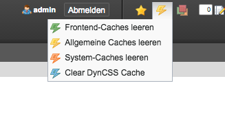
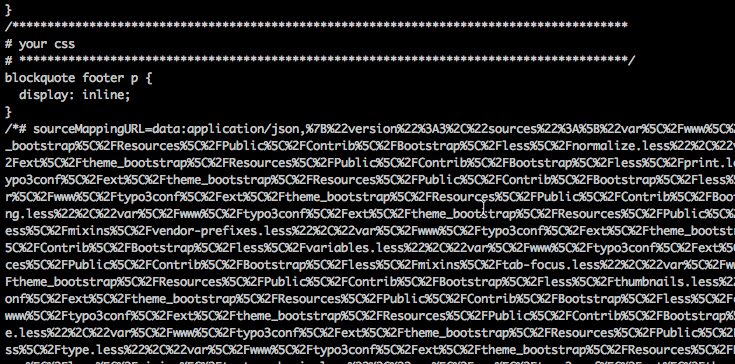

<a href="https://enjoy.gitstore.app/repositories/kaystrobach/TYPO3.dyncss"></a>

DynCss compiles dynamic stylesheets (less, scss, …) that are added to the page renderer, e.g. with
`page.includeCSS`. The compilers are separate extensions, which register themselves for a file ending:

* [dyncss_less](https://github.com/kaystrobach/TYPO3.dyncss_less) - `*.less`
* [dyncss_scss](https://github.com/kaystrobach/TYPO3.dyncss_scss) - `*.scss`

The compiled files are written to `typo3temp/assets/DynCss/` (older versions: `typo3temp/DynCss/`, which TYPO3 v14 no
longer allows as public resource). URLs in the stylesheets are rewritten relative to this folder.

Requirements
============

TYPO3 12.4, 13.4 or 14 (branch `typo3-12-13-14`, the branch `typo3-12` supports TYPO3 12 only).

Command line
============

```
vendor/bin/typo3 dyncss:compile EXT:my_ext/Resources/Private/Less/style.less
```

Compiles the file and prints the path of the CSS file. Overrides from TypoScript are not available on the command line.

Composer mode: imports between extensions
=========================================

Stylesheets written for the classic layout, where all extensions were folders below `typo3conf/ext/`, import files of
other extensions with relative paths:

```less
@import "../../../../theme_bootstrap/Resources/Private/Dyncss/import.less";
```

In composer mode the extensions are in `vendor/<vendor>/<package>/` and the path leads nowhere.
`KayStrobach\Dyncss\Utilities\LegacyExtensionPath::resolve()` takes the first folder after the `../` as extension key
and resolves the import in that extension. dyncss_less uses it for every import it can not resolve otherwise.

Less in general
===============

The parser libs may ship dedicated information based on the language you want to use.

Frontend
========

Example TYPOScript:

	page.includeCSS.testLess = EXT:dyncss_test/Resources/Public/Stylesheets/Example.less

Example Overrides (dynamic color settings, dynamic image overrides):

```typoscript
plugin.tx_dyncss {
	register = LOAD_REGISTER
	register {
		inputColor1.cObject = TEXT
		inputColor1.cObject {
			value = {$lessColorScheme}
			split {
				token.char = 124
				returnKey = 0
			}
		}
		inputColor2 < .inputColor1
		inputColor2.cObject.split.returnKey = 1
	}
	overrides {
		inputColor1 = TEXT
		inputColor1 {
			data = register:inputColor1
		}
		inputColor2 = TEXT
		inputColor2 {
			data = register:inputColor2
		}
		logo = IMG_RESOURCE
		logo {
			stdWrap.wrap = url("|")
			file = GIFBUILDER
			file {
				XY = [20.w],[20.h]
				20 = IMAGE
				20.file = GIFBUILDER
				20.file {
					XY = 128,22
					backColor.data = register:inputColor1
				}
				20.mask = EXT:example/css/colors/less/images/logo_sw.png
			}
		}
	}
	registerReset = RESTORE_REGISTER
}
```

Example less file:

```less
	@linkColor: blue;
	@logo: url(someWeirdUrl);

	a {
		color: @linkColor;
	}

	h1 {
		a {
			color: lighten(@linkColor, 20%);
		}
	}
	#logo {
		background-image:@logo
	}
```

Overrides
=========

In the frontend the overrides are rendered from `plugin.tx_dyncss.overrides` (see above). Since TYPO3 v13 the TypoScript
setup is not available for pages from the page cache, there are no overrides then. The compiled file of the first
rendering is used, as long as it exists.

Backend
=======

Dynamic stylesheets added to the page renderer of the backend are compiled as well, the overrides come from
`KayStrobach\Dyncss\Configuration\BeRegistry::get()->setOverride()`.

Caching
=======

In production mode, CSS is only re-rendered if the topmost less or sass file, which is directly included by typoscript, is altered.  
In development mode, also changes in files that are imported inside a less or sass file trigger a new rendering.  
Development mode is triggered either by TYPO3 application context "Development" or by the preset "Development" in the install tool.
Additionally rerendering will happen if you change TS values, which are used in the less files.

Additionally we add a new clear cache button to just clear the dyncss cache (cache command `dyncss`, available for
admins, users with `options.clearCache.system` and in the Development context).



Source maps
==========

If the compiling library supports source maps, you can enable that feature by enabling the debug mode of dyncss in the extension configuration (Settings > Extension Configuration > dyncss).

Normally the source maps are appended to the generated css files, to avoid confusion.

__IMPORTANT__

You need to disable css concatenation to get the sourcemaps working.

This can be done with the following TS based on your environment:
```
themes.configuration.css.concatenate = 0
page.config.concatenateCss = 0
```



Tests
=====

Functional tests in docker against TYPO3 12, 13 and 14 (SQLite):

```
Build/Scripts/runTests.sh -t 12             # TYPO3 12, also 13 or 14
Build/Scripts/runTests.sh -a                # all versions
Build/Scripts/runTests.sh -t 14 -- --filter DyncssServiceTest
```

Each version gets its own composer project in `.Build/v<version>`, `-u` updates its dependencies.

